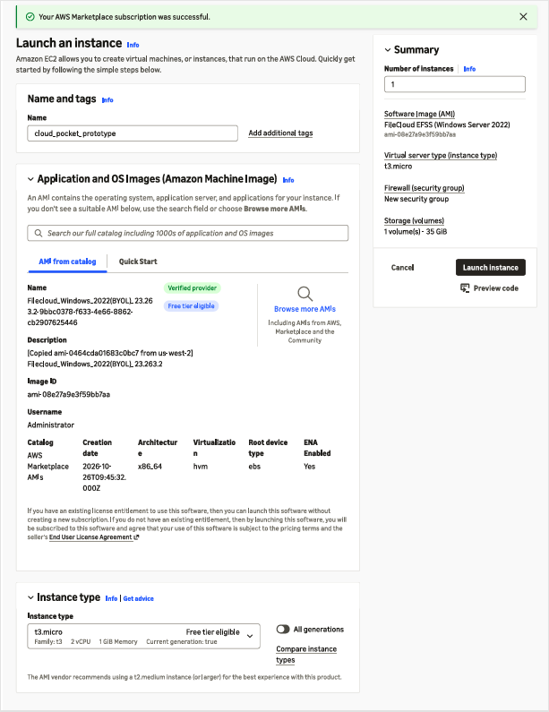
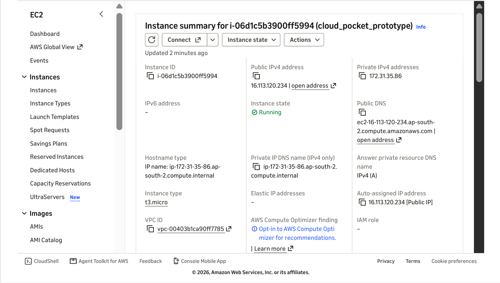
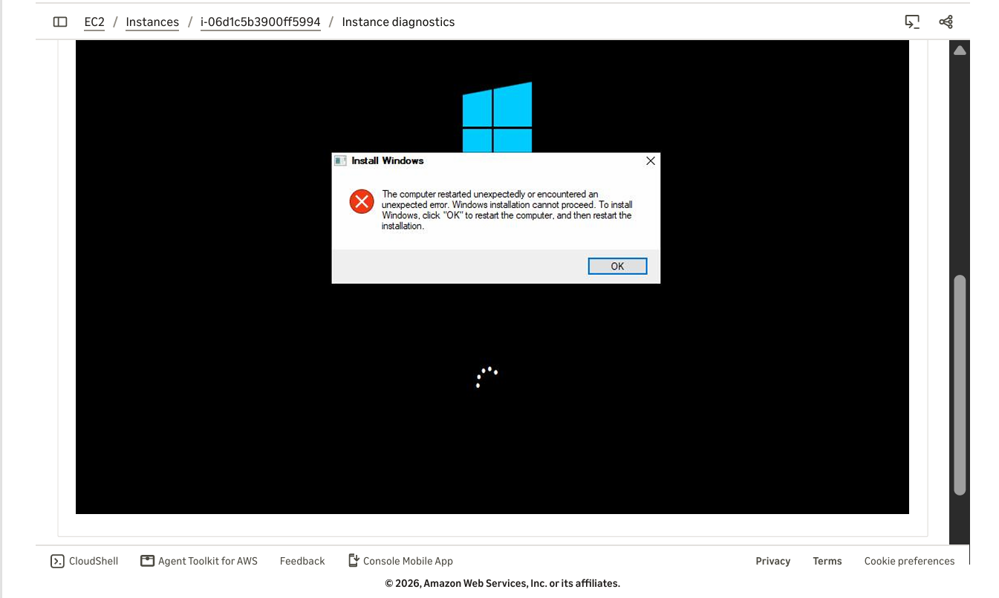
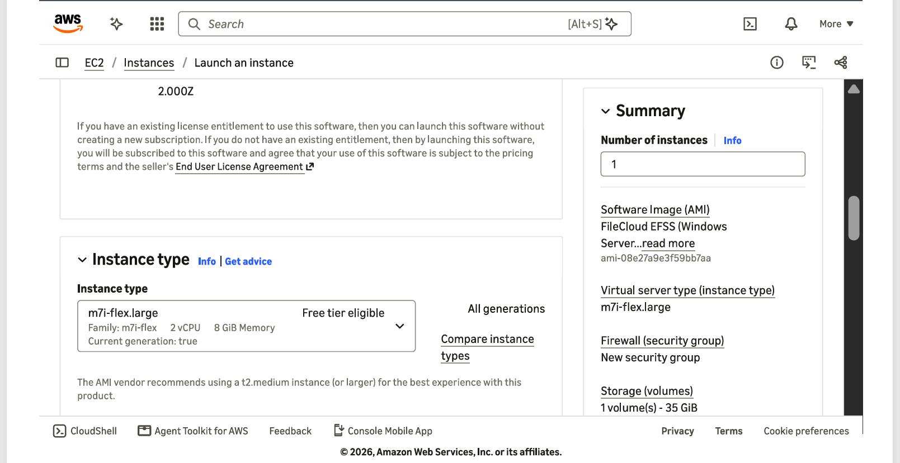
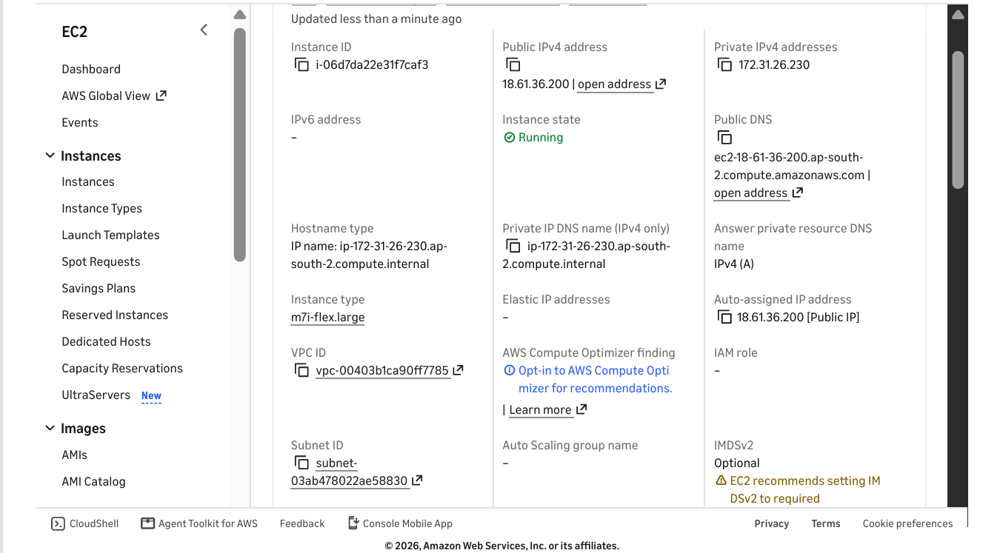
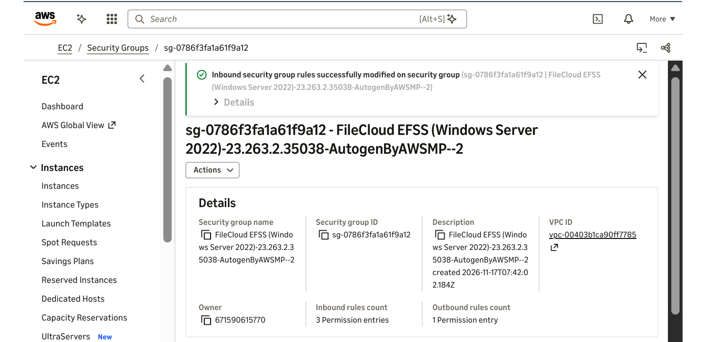
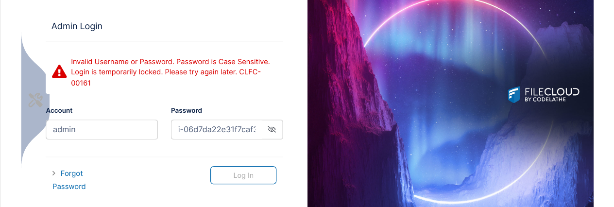
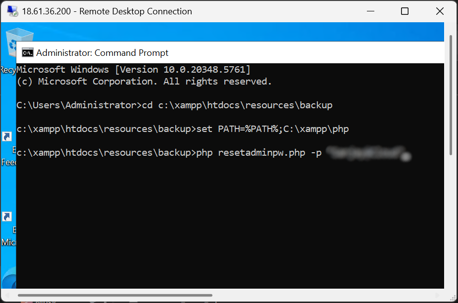

# Cloud in a Pocket

A personal cloud file-storage server built on **AWS EC2** using the **FileCloud** Marketplace AMI (Windows Server 2022), reachable from a browser and the FileCloud mobile app.

> **Status:** Phase 1 is complete (server running, license installed, **local EBS storage**, user upload working).
> **Phase 2 (final step, planned):** move file storage to **Amazon S3**. S3 was deliberately left until the end, after the server itself was stable.

**Author:** Sanjay

---

## Contents

1. [Architecture](#architecture)
2. [Tech stack](#tech-stack)
3. [Project phases](#project-phases)
4. [What I did, step by step](#what-i-did-step-by-step)
5. [Errors and fixes](#errors-and-fixes)
6. [Commands used](#commands-used)
7. [Phase 2: S3 storage (planned)](#phase-2-s3-storage-planned)
8. [Cost and stop/start notes](#cost-and-stopstart-notes)
9. [Security notes](#security-notes)
10. [Lessons learned](#lessons-learned)
11. [Repository structure](#repository-structure)

---

## Architecture

```
 Phone / Browser
       |
       |  HTTP 80 / HTTPS 443
       v
 +---------------------------------------+
 |  AWS EC2  (Windows Server 2022)       |
 |  FileCloud EFSS (Apache + MongoDB)    |
 |                                       |
 |  Phase 1: local EBS  C:\FileCloud\data|
 |  Phase 2: Amazon S3 bucket (planned)  |
 +---------------------------------------+
       ^
       |  RDP 3389 (admin only, My IP)
     Admin (me)
```

## Tech stack

| Layer | Choice |
|---|---|
| Cloud | AWS (region `ap-south-2`, Hyderabad) |
| Compute | EC2, instance type `m7i-flex.large` (after `t3.micro` failed) |
| Application | FileCloud EFSS, Windows Server 2022 Marketplace AMI |
| Storage | Phase 1: local EBS disk. Phase 2: Amazon S3 |
| Access | Web portal, FileCloud mobile app, RDP for administration |

## Project phases

| Phase | Goal | Status |
|---|---|---|
| 1 | Launch EC2 + FileCloud, fix access, install license, set local storage, create user, upload files | Done |
| 2 | Move storage to Amazon S3 (bucket + IAM user/policy + FileCloud S3 settings) | Planned (final step) |

---

## What I did, step by step

### 1. Initial configuration
- Opened the EC2 console and searched the AWS Marketplace for `FileCloud`.
- Picked **FileCloud EFSS (Windows Server 2022)**. I avoided the 20-user and 50-user listings because they bill an hourly software fee. The "Free Tier" badge only covers AWS infrastructure, not the FileCloud software fee.
- First attempt: instance type **t3.micro**, named `cloud_pocket_prototype`.



### 2. First instance failed
- The instance showed *Running*, but the FileCloud page never loaded.
- The status check later showed **"Instance status check failed"**.
- The instance screenshot (EC2 → Monitor and troubleshoot → Get instance screenshot) showed the Windows setup error: *"The computer restarted unexpectedly or encountered an unexpected error. Windows installation cannot proceed."*





### 3. Fix: bigger instance
- Windows first-boot setup kept crashing on the 1 GB RAM of `t3.micro` (most likely cause). Clicking OK only restarted the same loop.
- Terminated the failed instance and relaunched the same AMI on **`m7i-flex.large`** (2 vCPU, 8 GiB RAM).
- Windows finished setup and the FileCloud page loaded.





### 4. Security group
- Added inbound rules: HTTP 80, HTTPS 443, and RDP 3389 (see the table in [Security notes](#security-notes)).
- Used `http://<public-ip>/ui/admin/index.html` for the admin portal (plain `http`, because there is no certificate yet).



### 5. FileCloud first-run problems
- User page showed **`CLFC-01801 Storage system not ready`** because no storage location was configured yet.
- Admin login failed with **`CLFC-00161 Invalid Username or Password`**, then **"Login is temporarily locked"** after repeated attempts.



### 6. Remote Desktop and admin password reset
- First RDP attempts failed with **error `0x204`** (port 3389 not reachable). Fixed by correcting the RDP inbound rule.
- RDP then asked for credentials and pre-filled my own PC's Microsoft account. Used **More choices → Use a different account → `Administrator`** with the password decrypted in the AWS console from the key pair (`.pem`).
- Inside the server, reset the FileCloud admin password with `resetadminpw.php`, which also clears the admin login lock (commands below).



### 7. License
- Opening the trial-license URL directly returned XML with `<message>Not authenticated</message>`. That was only because I was not logged in to the admin portal in that browser session.
- Logged in as `admin` first, then installed the trial license key received by email under the license section.

### 8. Storage (local, Phase 1)
- On the server, created `C:\FileCloud\data`.
- Admin portal → **Settings → Storage** → **Local** → `C:\FileCloud\data`. The storage error was resolved.

### 9. Users and upload
- Admin portal → **Users → Add User** with *Default Authentication* and *Full (Licensed Account with storage)*.
- Logged in as that user at `http://<public-ip>/` and uploaded files; also connected through the FileCloud mobile app.

### 10. Other fixes and tweaks
- Emails from FileCloud contained the wrong IP. FileCloud builds email links from its **Service URL** setting, so I updated it under Customization → URL.
- Branding (product name, login background, email templates) is under **Customization**. Some label fields could not be edited, which may depend on the license edition.
- Stopped the instance (not terminated) when idle to save credits.

---

## Errors and fixes

| # | Error / symptom | Cause | Fix |
|---|---|---|---|
| 1 | FileCloud page not loading although instance was *Running* | Windows first-boot setup crashed (no web server running) | Relaunched on a larger instance type |
| 2 | "Instance status check failed" | Windows not responding | Screenshot showed setup failure; terminated and relaunched |
| 3 | "Windows installation cannot proceed" boot loop | `t3.micro` (1 GB RAM) too small for Windows Server 2022 | Used `m7i-flex.large` (8 GiB) |
| 4 | `CLFC-01801` Storage system not ready | No storage path configured | Created `C:\FileCloud\data`, set it under Settings → Storage |
| 5 | `CLFC-00161` Invalid username or password; login temporarily locked | Wrong credentials, then lockout after repeated attempts | Reset the password with `resetadminpw.php` (also clears the lock) |
| 6 | RDP error `0x204` | Port 3389 not reachable | Fixed the RDP rule in the security group; tested from another network |
| 7 | RDP login box pre-filled with my own Microsoft account | Default credentials on the client PC | Used "Use a different account" and the `Administrator` login |
| 8 | License URL returned `Not authenticated` XML | Not logged in to the admin portal in that session | Logged in first, then installed the license from the dashboard |
| 9 | Wrong IP in FileCloud emails | Service URL / IP not updated | Set the correct URL under Customization → URL |
| 10 | Admin page unreachable after a stop/start | Public IP and public DNS change on restart | Copy the new IP/DNS from the EC2 console (or use an Elastic IP) |

---

## Commands used

Run inside the server (RDP → **Command Prompt as Administrator**).

Reset the FileCloud admin password and clear the login lock:

```bat
cd c:\xampp\htdocs\resources\backup
set PATH=%PATH%;C:\xampp\php
php resetadminpw.php -p "<NEW_PASSWORD>"
```

Create the local storage folder:

```bat
mkdir C:\FileCloud\data
```

Test whether a port is reachable from a Windows PC (PowerShell):

```powershell
Test-NetConnection <public-ip> -Port 80
Test-NetConnection <public-ip> -Port 3389
```

URLs:

```
Admin portal : http://<public-ip>/ui/admin/index.html
User portal  : http://<public-ip>/
```

---

## Phase 2: S3 storage (planned)

Not done yet. This is the final step, after Phase 1 is stable.

1. **Create a bucket** in the same region as the instance (`ap-south-2`) with *Block all public access* on.
2. **Create an IAM user** (for example `filecloud-user`) with the policy in [`s3-iam-policy.json`](s3-iam-policy.json), replacing `YOUR-BUCKET`.
3. **Create an access key** for that user. Keep it secret and never commit it to GitHub.
4. In FileCloud: **Settings → Storage → Amazon S3**, enter bucket name, region and keys, then save.
5. Upload a test file and confirm it appears in the bucket.
6. Note: files already uploaded to local storage do not move automatically, so switch to S3 before adding real data.

*(Fill in results, screenshots and any errors here once Phase 2 is complete.)*

---

## Cost and stop/start notes

- **Stop** the instance when idle (never **Terminate**, which deletes everything). Compute and the hourly software fee stop; the EBS disk is still billed.
- After every start, the **public IP and public DNS change**. An Elastic IP keeps them fixed but public IPv4 addresses are charged, so check pricing first.
- The trial license keeps counting down while the instance is stopped.
- Set a **billing alarm** before leaving anything running.

## Security notes

Security group rules:

| Type | Port | Source | Purpose |
|---|---|---|---|
| HTTP | 80 | Anywhere | FileCloud web access |
| HTTPS | 443 | Anywhere | FileCloud web access (certificate not yet installed) |
| RDP | 3389 | **My IP only** | Admin access |

- RDP gives full control of the server, so it is restricted to my IP and removed when not needed.
- Never commit the `.pem` key, the Windows Administrator password, the FileCloud admin password or any AWS keys. See [`.gitignore`](.gitignore).
- Before uploading screenshots, hide email addresses, license keys, access keys and passwords. On this AMI the instance ID is the *default* admin password, so it is only safe to share because the admin password was changed and the instance is stopped. The public IP changes on every restart.
- Next hardening step: add a domain name and an HTTPS certificate (for example Let's Encrypt).

## Lessons learned

- "Free Tier eligible" on a Marketplace AMI covers the AWS infrastructure, not the vendor's software fee. Check the Pricing tab first.
- A *Running* instance with passing status checks does not mean the application is up. The instance screenshot shows what the OS is actually doing.
- Windows Server needs more than 1 GB RAM to finish first-boot setup.
- Stopping and starting changes the public IP and DNS.
- Repeated failed admin logins lock the account; resetting with the script clears it.

## Repository structure

```
cloud-in-a-pocket/
├── README.md
├── .gitignore
├── s3-iam-policy.json
└── screenshots/
    ├── 01-instance-initial-configuration.png
    ├── 02-failed-instance-t3micro.png
    ├── 03-instance-diagnostics-failure.png
    ├── 04-instance-type-change-m7i-flex-large.png
    ├── 05-new-instance-details.png
    ├── 06-filecloud-password-error.png
    ├── 07-security-group-rules.png
    └── 08-remote-desktop-commands.png
```
